<!-- Cinematic 'Noir · Gold & Crimson' profile.
     Every visual is a self-hosted animated SVG generated by scripts/ (see theme.py
     for the single source of truth). No external widget services, no JavaScript.
     Data-driven cards are refreshed on demand by .github/workflows/update-profile-art.yml. -->

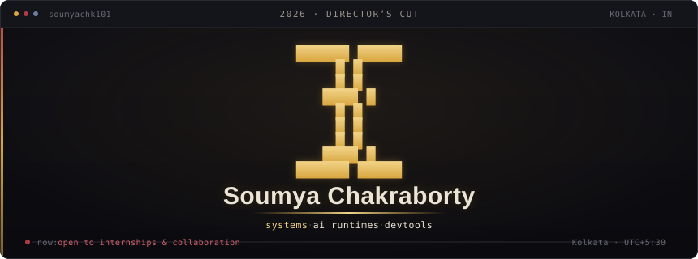
 
<code>
<a href="#whoami">[&nbsp;whoami&nbsp;]</a> &middot; <a href="#projects">[&nbsp;projects&nbsp;]</a> &middot; <a href="#hackathons">[&nbsp;hackathons&nbsp;]</a> &middot; <a href="#metrics">[&nbsp;metrics&nbsp;]</a> &middot; <a href="#languages">[&nbsp;languages&nbsp;]</a> &middot; <a href="#contact">[&nbsp;contact&nbsp;]</a>
</code>
  

  

<h3><code>soumyachk101@github:~$ whoami</code></h3>

  

  

<h3><code>soumyachk101@github:~$ ls -la ~/projects</code></h3>

<a href="https://github.com/soumyachk101/Ensembyte"></a> 
  
<a href="https://github.com/soumyachk101/Veylqorix"></a> 
  
<a href="https://github.com/soumyachk101/VERCODE"></a> 
  
<a href="https://github.com/soumyachk101/Credow"></a> 
  
<a href="https://github.com/soumyachk101/DrishtiNet"></a> 

  

  

<h3><code>soumyachk101@github:~$ cat hackathons.txt</code></h3>

  
<a href="https://ensembyte.vercel.app">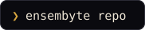</a>&nbsp;<a href="https://veylqorix.vercel.app">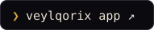</a>&nbsp;<a href="./ISRO_Hackathon_Certificate.png">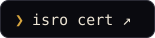</a>&nbsp;<a href="https://github.com/soumyachk101/Credow">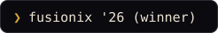</a>

  

  

<h3><code>soumyachk101@github:~$ ./telemetry --leetcode --contributions</code></h3>

<a href="https://leetcode.com/u/soumya-chk101/"></a>
  
<a href="https://leetcode.com/u/soumya-chk101/"></a>
  
<a href="https://leetcode.com/u/soumya-chk101/"></a>
  

  
<a href="https://github.com/soumyachk101"></a>

  

  


  

  

<h3><code>soumyachk101@github:~$ cat languages.txt</code></h3>


  

  

<h3><code>soumyachk101@github:~$ cat contact.txt</code></h3>

<a href="https://soumya.pro">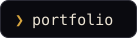</a>&nbsp;<a href="https://x.com/soumyachk1">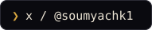</a>&nbsp;<a href="https://leetcode.com/u/soumya-chk101/">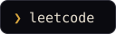</a>&nbsp;<a href="mailto:soumya.chk101@gmail.com">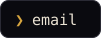</a>

  
 

